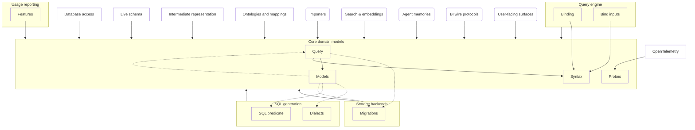

# core — domain models, keys, errors

## 1. Purpose & context

`slayer/core` holds the domain models, the `ValueKey` structural-identity
family, and the typed error/warning vocabulary.

## 2. Building blocks

The `core_focus` view ([views.c4](views.c4)) — `core` and its incident edges:

<!-- likec4:core_focus -->

*Dashed arrows: legacy edges slated to die.*
<!-- /likec4:core_focus -->

Identity: `keys.py`; scopes:
`scope.py`; errors/warnings: `errors.py`, `warnings.py`; Pydantic domain
models alongside; the Mode B grammar: `syntax.py`.

## 3. Principles

1. **A key answers one question**: a `ValueKey` identifies a value —
   "are these two expression occurrences the same?" — and carries nothing
   else; rendering state lives on slots, never on keys. [review]
2. **Local and cross-model share one key shape**: the join path is data (empty
   vs non-empty `path`); there is no separate cross-model track, and the render
   strategy is chosen downstream, never baked into identity. [review]
3. **Traversal is total by construction**: every key kind implements the
   `children()` / `map_children()` protocol so generic walkers and rewriters
   cover new kinds the day they are added; deliberately asymmetric visitors
   keep explicit dispatch with a fail-closed raise tail. [review]
4. **One key kind per meaning**: a construct with an existing kind's shape and
   meaning reuses it; anything else is a new kind, never a reserved name
   bending an existing kind's contract. Every kind dispatch fails closed on a
   kind it does not handle. [review]
5. **Errors are typed, with a stable format**: intentional failures are
   `SlayerError` subclasses rendered via `_format_error_message`
   [target: DEV-1969]; the checker's `QueryTypeError` family already is.
   [enforced: test:tests/test_dev1871_raise_parity.py]
6. **Warnings are structured payloads, surfaced twice**: degradations emit
   payload-carrying warnings that appear both as Python warnings and on
   `SlayerResponse.warnings` — never only a log line. [review]
7. **`core` imports no other SLayer node.** The remaining crossings are the
   grandfathered child-level `#legacy` doors (`core.query`/`core.models` →
   `sql.*`, `storage.migrations`), slated to die.
   [enforced: arch_check:model-truth]
8. **Input refuses what it does not read**: a fresh query or dataset object carrying a key it does not read is refused with a typed error naming the key, never silently dropped. [enforced: test:tests/test_law_query_input_refuses_unknown_keys.py] [review]
9. **Every write is checked**: an attribute assigned on a dataset or query object passes the checks construction applies, and a refused assignment leaves the object unchanged. [enforced: test:tests/test_law_dataset_objects_validate_assignment.py] [enforced: test:tests/test_query_assignment_validation.py]

## 4. Rationale

Structural identity (P1) keeps the duplicate/shared-slot bug family
unrepresentable; one key shape (P2) keeps the intermediate representation free
of parallel per-family tracks.
