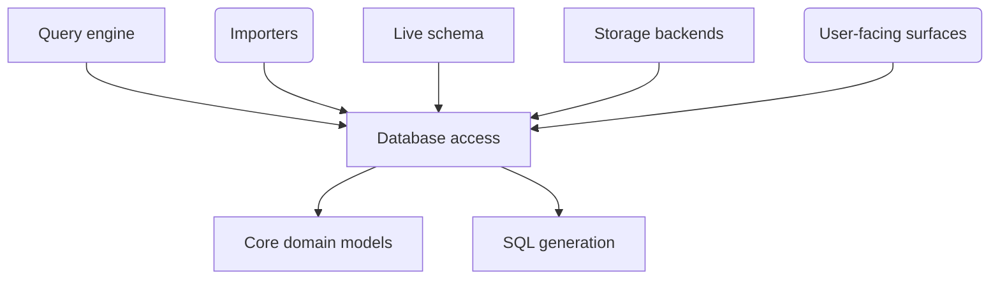

# database — database access

## 1. Purpose & context

`slayer/database` is SLayer's door to live databases: the SQL client contract
and its default client (`client.py`), the engine factory (`engine_factory.py`),
SQLite introspection (`sqlite_introspect.py`) and the executable client
conformance check (`conformance.py`). It executes the SQL `sql` renders and
builds none.

## 2. Building blocks

The `database_focus` view ([views.c4](views.c4)):

<!-- likec4:database_focus -->

<!-- /likec4:database_focus -->

## 3. Principles

1. **One database door**: every live database access — statement or metadata —
   goes through a client owned by a query engine.
   [enforced: test:tests/test_law_database_door.py]
2. **Rendered SQL executes verbatim**: every statement reaches its executing
   client unchanged; `client.py` hands it to the DBAPI through one door
   (`exec_driver_sql`, no parameters); SQLAlchemy `text()` never touches
   rendered SQL — `:name` is never a bind parameter, `%` never a format
   directive. [enforced: test:tests/test_dev1933_verbatim_execution.py]
3. **One engine owner**: every SQLAlchemy engine is disposed by exactly one
   owner — `engine_factory` for the engines it caches (eviction and
   `reset_cache` always dispose; `:memory:` is built by its single builder,
   keyed per datasource), `SlayerSQLClient` for its private in-memory
   engine (via `close()`, with a finalizer backstop) and its async engines, one
   per event loop, each released only on its own loop. `create_engine` runs only
   in the factory and the dialects' build hooks; `create_async_engine` only in
   the client's async builder. [enforced: test:tests/test_law_resource_ownership.py]
   [enforced: test:tests/test_sql_client_event_loops.py]
4. **One driver per client**: a client reaches its database through one driver
   only — its caller's engine's, else its URL's (the one named, else the type's
   default); no URL is rewritten to another driver.
   [enforced: test:tests/test_one_driver_per_client.py]
5. **One request per statement**: on a warm connection a statement costs the database one
   request — session state is set once per connection and re-set only when it changes, liveness is
   checked only after idle, and connections persist across calls, synchronous ones included, save idle
   ones holding a local database file, which a synchronous call releases on return; a datasource
   marked as reached through a transaction-mode pooler keeps its timeout transaction-local instead. [enforced: test:tests/test_law_one_request_per_statement.py]
6. **One thread per connection**: a database connection is used by one thread at a time.
   [enforced: test:tests/test_law_one_thread_per_connection.py]
7. **Read-only datasources**: except into an in-memory database, a connection is read-only wherever
   its backend is live-tested and allows it, and the client sends no statement it cannot classify as a
   read. [enforced: test:tests/test_law_read_only_datasources.py]

## 4. Rationale

The client is the one place SLayer holds a live connection, so every rule about
statements, engines and drivers binds there and nowhere else (archived changes
`2026-09-19-dev-1933-slayer-satext-misreads-word-in-rendered-sql-as-a-bind`,
`2026-09-21-dev-1943-executed-test-fixtures-leak-undisposed-engines-unclosed`,
`2026-10-20-dev-2116-a-connection-url-that-names-no-driver-always-uses-slayers`,
`2026-11-02-dev-2181-injectable-sql-client-factory-so-the-query-engine-executes`).
