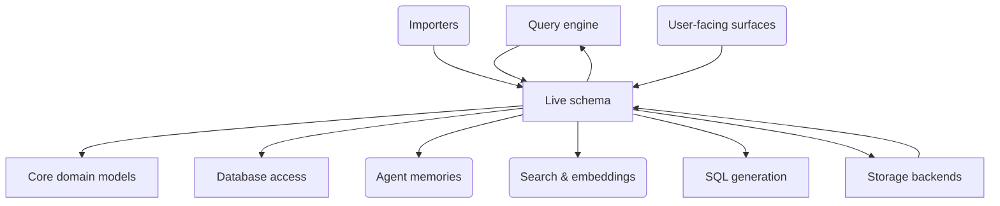

# live_schema — live schema

## 1. Purpose & context

`slayer/live_schema` reconciles stored models with what a live database holds:
ingestion (`ingestion.py`), schema drift and scope (`schema_drift.py`,
`schema_scope.py`), introspection helpers (`introspect_utils.py`),
broken-dependent checks (`broken_dependents.py`), internal-table rules
(`internal_tables.py`), FK-edge planning (`fk_edges.py`) and storage-driven
type refinement (`type_refinement.py`).

## 2. Building blocks

The `live_schema_focus` view ([views.c4](views.c4)):

<!-- likec4:live_schema_focus -->

<!-- /likec4:live_schema_focus -->

## 3. Principles

1. **Ingestion is idempotent and additive-only**: user metadata is never
   overwritten by a re-ingest (documented exceptions: the `source_kind`
   refresh, and a non-list column re-typed to the list its live column is). [review]
2. **One treatment per model source**: an `sql`-mode model is typed,
   re-typed, validated and drift-checked exactly like a `sql_table` model
   wherever the live database can tell the same about both; any difference
   is a documented exception. [review]

## 4. Rationale

Re-ingesting must never cost a user an edit, and a model's source kind must
never decide which checks protect it; both rules bind where stored models meet
the live schema.
