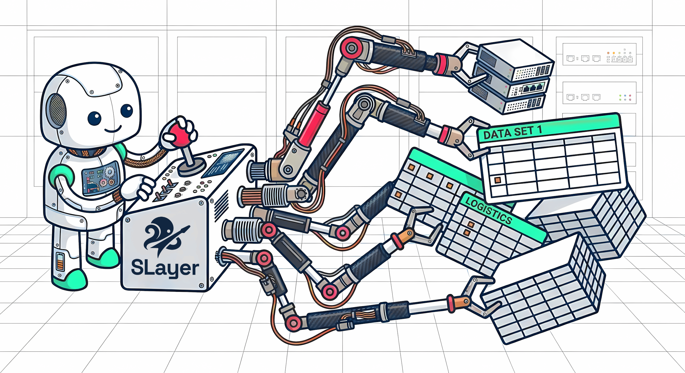

# SLayer — Semantic Layer for AI Agents

<p align="center">
  
</p>

A lightweight, open-source semantic layer by [MotleyAI](https://github.com/motleyai). Agents describe what data they want — measures, dimensions, filters — and SLayer generates the SQL.

[GitHub](https://github.com/MotleyAI/slayer) | [PyPI](https://pypi.org/project/motley-slayer/) | [Discord](https://discord.gg/egWxMctHCA)

## Why?

When AI agents write raw SQL, they can get joins wrong, and produce metrics that drift between queries. 

Existing semantic layers (Cube, dbt semantic layer) were built for dashboards — heavy infrastructure, slow model refresh cycles, and not enough flexibility for ad-hoc agent queries.

SLayer is different: models are editable at runtime, aggregation is chosen at query time, and there's no build step.

## What it looks like

Given the demo's `orders` [model](concepts/models.md), with an `order_total` column and a join to `stores` and on to `regions`:

```json
{
  "source_model": "orders",
  "measures": [
    "sum(order_total)",
    {"formula": "change_pct(sum(order_total))", "name": "mom_growth"},
    {"formula": "sum(order_total) / time_shift(sum(order_total), -1, 'year') - 1", "name": "yoy_growth"},
    "last(stores.name, stores.opened_at)"
  ],
  "dimensions": ["stores.regions.name"],
  "time_dimensions": [{
    "dimension": "ordered_at",
    "granularity": "month",
    "date_range": "last 12 months"
  }],
  "filters": ["status = 'completed'", "change(sum(order_total)) > 0"],
  "order": [{"column": "order_total_sum", "direction": "desc"}]
}
```

One query, and SLayer handles:

- **`sum(order_total)`** — aggregation is chosen at query time, not baked into the column definition. The same `order_total` column works with `sum`, `avg`, `median`, `weighted_avg`, or [any custom aggregation](examples/07_aggregations/aggregations.md). Add `partition_by=` for a coarser grain repeated across rows — `sum(order_total) / sum(order_total, partition_by=stores.regions.name)` is share-of-parent.
- **`change_pct(sum(order_total))`** — month-over-month growth as a [transform](examples/04_time/time.md). SLayer generates the necessary window query. Other built-in transforms: `cumsum`, `change`, `time_shift`, `rank` / `percent_rank` / `dense_rank` / `ntile`, `lag`, `lead` — all nestable (`"change(cumsum(sum(order_total)))"` works).
- **`sum(order_total) / time_shift(sum(order_total), -1, 'year') - 1`** — arithmetic on aggregated measures. `time_shift` runs a separate time-shifted sub-query and joins it back by all dimensions; dividing by it gives year-over-year growth. Standard operator precedence applies.
- **`last(stores.name, stores.opened_at)`** — a measure from a [joined model](examples/05_joined_measures/joined_measures.md), resolved by walking the [join graph](examples/05_joins/joins.md). `last` is an aggregation that picks the latest record's value — `stores.opened_at` tells it which column defines "latest", so this is the region's newest store.
- **`stores.regions.name`** — a multi-hop dimension: SLayer traces `orders → stores → regions` and builds the joins automatically.
- **`change(sum(order_total)) > 0`** — filtering on a computed transform. SLayer computes the transform first as a hidden field, then applies the filter on the outer query.

## What SLayer does

- **[Auto-ingestion](concepts/ingestion.md)** — Point it at a database, it introspects the schema, detects foreign keys, and generates models with joins. No manual YAML needed to get started ([tutorial](examples/03_auto_ingest/auto_ingest.md)). Re-run the same idempotent pass on every server boot with `slayer serve --ingest-on-startup` / `slayer mcp --ingest-on-startup`.
- **Aggregation at query time** — Measures are expressions, not pre-baked aggregates. `"sum(order_total)"`, `"median(order_total)"`, `"weighted_avg(order_total, weight=subtotal)"`. Built-in and [custom aggregations](examples/07_aggregations/aggregations.md) with parameters.
- **Composable transforms** — `cumsum`, `change`, `change_pct`, `time_shift`, `rank` / `percent_rank` / `dense_rank` / `ntile`, `lag`, `lead` — all nestable: `"change(cumsum(sum(order_total)))"` just works ([tutorial](examples/04_time/time.md)).
- **Cross-model measures** — Query measures from [joined models](examples/05_joined_measures/joined_measures.md) with dot syntax: `"avg(stores.tax_rate)"`. Joins are auto-resolved by walking the model graph ([tutorial](examples/05_joins/joins.md)).
- **[Multistage queries](examples/06_multistage_queries/multistage_queries.md)** — Use one query as the source for another, or save any query as a permanent model.
- **Runtime model editing** — Add measures, dimensions, and joins through any interface. No rebuild, no restart.
- **[Memories + semantic search](concepts/search.md)** — Persist free-form learnings tagged with canonical entities (`<datasource>.<model>.<column>`) and retrieve them alongside model / column discovery hits via a single `search` call. Three retrieval channels (BM25 over memory tags + Tantivy full-text + optional dense embeddings) are RRF-fused into one flat ranked list. Optional graph pre-filter via `cypher_filter` ([memories concept](concepts/memories.md)).
- **Broad database support** — Integration-tested against Postgres, MySQL, ClickHouse, DuckDB, and SQLite. Others via sqlglot.

## Get started
- **[MCP](getting-started/mcp.md)** — for AI agents (Claude Code, Cursor, etc.)
- **[CLI](getting-started/cli.md)** — query from the terminal, manage models and datasources
- **[REST API](getting-started/rest-api.md)** — build apps in any language
- **[Python SDK](getting-started/python.md)** — embed SLayer directly, no server needed

## Under the hood

<!-- doc-check: not-a-query -->
```
Agent --> MCP / REST API / Python SDK
              |
         SlayerQuery (source_model, measures, dimensions, filters)
              |
         SlayerQueryEngine (resolves model definitions from storage)
              |
         PlannedQuery (typed value keys, slots, join paths, phases)
              |
         SQLGenerator (sqlglot AST --> dialect-aware SQL)
              |
         SlayerSQLClient (SQLAlchemy --> database)
              |
         SlayerResponse (data, columns, sql)
```

**SlayerQuery** is what the user sends — names and references, no SQL. **PlannedQuery** is the engine-internal form: every measure and dimension is a typed *value key* interned into a slot, carrying its resolved expression, aggregation, join path, and phase. New datasource adapters only need to translate PlannedQuery.

Full concept docs: [Models](concepts/models.md) | [Queries](concepts/queries.md) | [Formulas](concepts/formulas.md)
